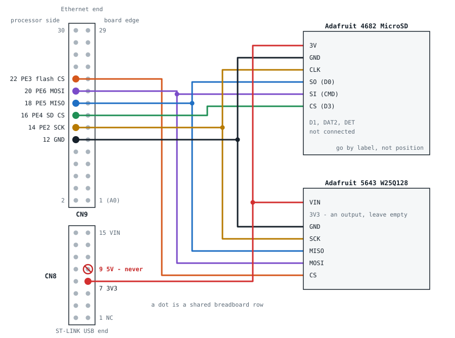

# NUCLEO-F767ZI board

ST's NUCLEO-F767ZI: an STM32F767ZI, which is a Cortex-M7 with on-board
Ethernet, and an ST-LINK that gives flash, reset, debug and a serial port over
one USB cable. The `nucleo-f767zi-*` presets select it, the BDD target ones with
`SOLIDSYSLOG_BDD_BOARD=NucleoF767zi`.

CI builds firmware for this board and never runs it. Running it is done on a
development machine with the board attached, and recorded against the
[target checklist](#target-checklist) below. For the BDD target that is
[one command](#running-the-bdd-scenarios).

Everything a target needs from the board is in this directory, behind the
board seam. [`../Board.cmake`](../Board.cmake) says what a board supplies to the
build, and the `BddTargetBoard*.h` headers in [`../../Common/`](../../Common/)
say what it supplies to the code.

## What is here

| Part of the seam | File | How this board fills it |
|---|---|---|
| Toolchain | `cmake/arm-none-eabi-cortex-m7.cmake` | `arm-none-eabi-gcc` for a Cortex-M7 with the hard-float ABI |
| Startup and vectors | - | ST's `startup_stm32f767xx.s` and `system_stm32f7xx.c`, compiled from the pinned tree as they stand |
| Linker script | `stm32f767zi.ld` | 2 MiB of flash at `0x08000000`, 384 KiB of RAM at `0x20020000`, the first 16 KiB of it for the Ethernet DMA |
| Clock, NVIC and disk facts | `BddTargetBoardConfig.h` | 216 MHz, four priority bits, a disk of 8 MiB |
| Network addresses | `BddTargetBoardAddresses.h.in` | Written into the build tree by the configure, from cache variables |
| Caches, clock, console, LEDs, millisecond count | `Board.c`, `stm32f7xx_hal_conf.h` | Over ST's HAL. Both [caches](#caches) are on. The millisecond count is TIM6, so SysTick is the kernel's |
| Console, exit and fault | `BddTargetBoard.c` | USART3 through `Board.c`; an exit is a line on the console and a halt, and so is a fault |
| Clock of the time of day | `BddTargetBoardClock.c`, `BoardRtc.c` | The part's [real-time clock](#clock), read to the microsecond, once `set time` has set it |
| Disk | `BddTargetBoardDisk.c`, `BddTargetBoardSdCardBus.c`, `BddTargetBoardNoDisk.c` | A [MicroSD card](#disk) on SPI4, under the card driver in the targets' common code. `BddTargetBoardNoDisk.c` is the disk of a target the board [has none for yet](#what-the-board-does-not-have-yet) |
| Ethernet under lwIP | `Lwip/BddTargetBoardNetif.c`, `Lwip/EthernetPhy.c` | A netif over ST's HAL Ethernet driver, and the PHY's link read from its standard registers |
| CMSIS device header | `BddTargetCmsisDevice.h` | ST's own, which the CMSIS-RTOS2 wrapper reads the core from |

`Bringup/` is not part of the seam. It is an image of its own, with no
SolidSyslog, no kernel and no network stack in it, built straight on `Board.c`:
a banner on the serial port, each line received echoed back, and the green LED
blinking. It is what tells a fault in the board or the toolchain from one in
anything built on them. Its `probe` command does the same for the
[storage breakouts](#storage-breakouts-spi4): it asks each whether it is
there, with no driver under it.

ST's HAL driver and CMSIS device files are not in the repository. The cross
image pins them, and the build reads them from `STM32F7_HAL_DRIVER_PATH` and
`STM32F7_CMSIS_DEVICE_PATH`.

## Build

In the `cpputest-freertos-cross` image. The bring-up image:

```bash
cmake --preset nucleo-f767zi-bringup
cmake --build --preset nucleo-f767zi-bringup --target SolidSyslogNucleoF767ziBringup
```

It lands at
`build/nucleo-f767zi-bringup/Bdd/Targets/Boards/NucleoF767zi/Bringup/SolidSyslogNucleoF767ziBringup.elf`,
with a raw `.bin` beside it. The `build-nucleo-bringup` CI lane builds the same
thing on every pull request and uploads both as the
`solid-syslog-nucleo-f767zi-bringup` artifact.

The FreeRTOS + lwIP Raw BDD target, which is
[`../../FreeRtosLwip/`](../../FreeRtosLwip/README.md) built for this board:

```bash
cmake --preset nucleo-f767zi-lwip \
    -DSOLIDSYSLOG_BDD_BOARD_IP=<board address> \
    -DSOLIDSYSLOG_BDD_BOARD_NETMASK=<netmask> \
    -DSOLIDSYSLOG_BDD_BOARD_GATEWAY=<gateway address> \
    -DSOLIDSYSLOG_BDD_BOARD_ORACLE=<collector address>
cmake --build --preset nucleo-f767zi-lwip --target SolidSyslogBddTargetLwip
```

It lands at
`build/nucleo-f767zi-lwip/Bdd/Targets/FreeRtosLwip/SolidSyslogBddTargetLwip.elf`.
The `build-nucleo-freertos-lwipraw` CI lane builds it on every pull request,
without the four addresses, and uploads it as the
`solid-syslog-nucleo-f767zi-freertos-lwip` artifact.

The CMSIS-RTOS2 + lwIP Sockets BDD target, which is
[`../../CmsisLwip/`](../../CmsisLwip/README.md) built for this board, takes the
same four addresses:

```bash
cmake --preset nucleo-f767zi-cmsis-lwip \
    -DSOLIDSYSLOG_BDD_BOARD_IP=<board address> \
    -DSOLIDSYSLOG_BDD_BOARD_NETMASK=<netmask> \
    -DSOLIDSYSLOG_BDD_BOARD_GATEWAY=<gateway address> \
    -DSOLIDSYSLOG_BDD_BOARD_ORACLE=<collector address>
cmake --build --preset nucleo-f767zi-cmsis-lwip --target SolidSyslogBddTargetCmsis
```

It lands at
`build/nucleo-f767zi-cmsis-lwip/Bdd/Targets/CmsisLwip/SolidSyslogBddTargetCmsis.elf`.
The `build-nucleo-cmsisrtos-lwipsocket` lane builds it and uploads it as the
`solid-syslog-nucleo-f767zi-cmsis-lwip` artifact. It is built over Mbed TLS;
the wolfSSL build of the same target is not built for this board.

The two are images of one board, and what the rest of this page says of the
BDD target is true of both unless it names one.

## Network

The board takes a static address. Its own address, its netmask, its gateway
and the address it reaches the collector at are facts about the network it is
plugged into, so they are build-time settings, the four cache variables above,
and none of them is written in this repository. `SOLIDSYSLOG_BDD_BOARD_MAC`
sets the hardware address, six hexadecimal octets separated by colons, and
defaults to a locally administered one.

Left unset, the addresses default to ones from the block RFC 5737 reserves for
documentation. That is what CI builds, so the image CI uploads reaches nothing,
and a run on the board uses an image built for the network under test.

The collector does not have to be on the board's own network: one that is not
is reached through the gateway.

The on-board PHY negotiates its link, and the target follows it. The target
puts the PHY in that mode itself as it boots, and resets it into the mode
before it resets the MAC. The PHY takes its mode from strap pins as it leaves
reset, and after a reset through the debug probe about one boot in twenty has
it in some other: most have negotiation off, where it would never report a
negotiated link, and one powers it down, where it gives the MAC no clock and
the MAC does not start. Each change of the link is a line on the console, so a
pulled cable can be told from a fault:

```text
[board] link down
[board] link up, 100 Mbit/s full duplex
```

A send while the link is down fails, and the library reports it as it reports
any failed delivery.

The interface copies every frame, in both directions, between lwIP's memory and
buffers of its own that the Ethernet DMA reads and writes. Those buffers are
kept out of the data cache, as [Caches](#caches) has it.

Jumpers JP6 and JP7 carry two of the RMII signals to the PHY, and both must be
fitted.

The MAC's reset completes only while the PHY supplies its 50 MHz reference
clock. If it does not complete, the console says
`[board] ethernet the MAC did not start` and the interface stays without a link.

## Caches

Every image on the board runs with the Cortex-M7's instruction cache and data
cache on, the bring-up image included. The board support turns them on before
anything else.

The Ethernet DMA reads and writes memory without the processor, so what the
data cache holds of that memory can be out of date, and what it has not yet
written back the DMA never sees. The DMA's descriptors and frame buffers are
therefore kept in 16 KiB at the bottom of RAM that the board support gives to
the memory protection unit as a region the data cache does not hold. The
linker script names the region and the interface places its descriptors and
buffers there.

The other way to keep that memory coherent is to leave it cached and clean or
invalidate the cache around each transfer. A region was chosen over that for
two reasons. ST's Ethernet driver, which is compiled as it stands, reads and
writes the descriptors itself and maintains no cache, so the descriptors need
the region whatever is done for the buffers. And with the buffers beside them
there is one mechanism, set once at start-up, and no call that every transfer
has to remember. What it costs is that the one copy each frame takes is to or
from memory that is not cached.

With the caches on and that region not set, no message from the board reaches
the collector, over UDP or over TCP.

## Clock

The board knows the time of day once it has been told it. `set time <seconds>`
at the console gives it UTC in seconds since the epoch, and the STM32's
real-time clock keeps it from there on its own 32.768 kHz crystal, through
every reset. A board that has been told sends a TIMESTAMP on each message and
`tzKnown="1" isSynced="1"`. One that has not sends NILVALUE and
`tzKnown="0" isSynced="0"`. The clock stops when the board loses power, because
nothing supplies it but the USB cable, so a board plugged in again has to be
told again. A BDD run tells it [before its first scenario](#running-the-bdd-scenarios).

The real-time clock keeps the seconds and nothing finer is taken from it once
the target is running. It interrupts as each second starts, and a reading of
the time is that second plus how far into it the reading is, measured on the
core's cycle counter, which counts the 216 MHz system clock. So a reading is to
the microsecond and costs a few instructions, where reading the real-time clock
itself would give four milliseconds at best. The cycle counter is part of the
core's debug unit. It runs with no debugger attached, and it is used so that
the clock takes none of the part's timers.

Two things follow from there being two oscillators. The crystal and the system
clock drift against each other, by some tens of microseconds in a second, so a
second as the cycle counter measures it can end a little before or after the
real-time clock says it has. A reading never passes the end of its second, and
the next second starts where the real-time clock puts it, so the time does not
go back. And a target that has just been reset has had no interrupt yet, so
until the first one it reads from where the real-time clock's own sub-second
count put it at start-up, which is good to about four milliseconds.

The real-time clock holds two digits of year and is taken as set when the year
is not zero, so `set time` takes a time from 2001 to 2099 and answers
`set: invalid` to any other. It answers the same if the real-time clock could
not be started. That is a crystal that did not start, which the target waits
up to five seconds for when it is first powered, or a clock that other
firmware, run on the board since it was powered, left on another source.

The bring-up image does not start the clock.

## Disk

The board's disk is a MicroSD card in a breakout on SPI4, wired as the
[pin plan](#storage-breakouts-spi4) has it. `set store file` mounts FatFs on
it, formatting it first if it finds no filesystem, and puts the target on a
store of files there. The disk is the first 8 MiB of the card, whatever the
card's size, which is the size of the disk the same target has under QEMU. A
card smaller than that is refused.

The card is the FreeRTOS + lwIP Raw target's disk. The CMSIS-RTOS2 target is
[not given it](#what-the-board-does-not-have-yet), and the rest of this section
is about the first.

A card that has been used anywhere else is wiped first, with `set store wipe`.
A card as it is sold, or as a computer formats it, has a partition table in
its first sector, naming a filesystem that reaches beyond those 8 MiB. FatFs
finds the table and follows it, so the mount either fails or succeeds on a
filesystem most of which the disk cannot reach, and in neither case formats.

The card is driven in SPI mode, a sector at a time, by a driver of this
repository's own in the targets' common code, which is unit-tested on the host
against a fake card. It drives a version 2 card, of standard or high capacity,
and refuses a version 1 card and an MMC. The one card it has been run on is a
SanDisk Ultra 8 GB microSDHC, so the standard capacity path has been run
against the fake only.

The card is started at 211 kHz and then run at 6.75 MHz. The breakout is on a
breadboard, at the end of jumper wires, and the rate is half the fastest found
clean on them: 3000 messages went through the file store at 13.5 MHz with no
transfer repeated, and at 27 MHz the card did not come up. The card's CRC
checking is turned on, so a command or a sector damaged on the wires is
refused by whichever end receives it. A read or a write that fails that way is
tried again, twice, and the target says on the console that it was, so wires
that have started to give trouble show before they stop a run.

A sector that still will not transfer, for that reason or any other, has the
card started again from the beginning and is tried once more. That brings back
a card that lost its place when a wire came out and went back.

Each byte is exchanged through SPI4's data register directly. ST's HAL has a
call for it, which times every transfer against the millisecond count, and a
task that is switched out for longer than the time it allows comes back to a
byte that was exchanged and is told that it failed. Under a load of messages
that showed as sectors failing their CRC, and a store that froze.
SPI4's slowest rate is its bus clock divided by 256, and a card has to be
started at no more than 400 kHz, so the board runs that bus at 54 MHz where
the part would allow 108.

The card keeps what it holds through a reset and with the power off, where the
disk under QEMU is a file the harness removes. `set store wipe` at the console
leaves the card with no filesystem on it, so that the next `set store file`
formats it. It is refused once the store is on the disk.

Whatever goes wrong with the card is a line on the console beginning
`[board] disk:`, with the sector where there is one and the reason: no answer,
timed out, CRC failed, and so on. A card that is not there, or a wire that has
come out of the breadboard, is `[board] disk: the card did not start: no
answer`, and `set store file` then answers `set: invalid` and leaves the target
on the store it started with.

## What the board does not have yet

- TLS is linked, because the target is the same code as on QEMU, and has not
  been run. The board's hardware random number generator is not wired in.
- The CMSIS-RTOS2 target has no store. Its filesystem is LittleFS, which
  belongs on the W25Q128 flash, and that has no driver yet. Until it has, the
  board gives this target a disk that never becomes ready: `set store file`
  says `[solidsyslog] littlefs mount failed`, answers `set: invalid` and
  leaves the target on the store it started with, and `set store wipe`
  answers `set: invalid` too.

## Tools on the development machine

Nothing here needs an IDE.

| Tool | From | Used for |
|---|---|---|
| `STM32_Programmer_CLI` | STM32CubeCLT, or STM32CubeProgrammer alone | Flash and reset |
| `ST-LINK_gdbserver` | STM32CubeCLT | The gdb server |
| `arm-none-eabi-gdb` | STM32CubeCLT, or any Arm GNU toolchain | Debug |
| A serial terminal | Any | The console |
| `gh` | GitHub CLI | Fetching the image CI built |
| A syslog collector | The OpenTelemetry Collector under `Bdd/otel/` | Receiving what the board sends |
| Python, with `Bdd/requirements.txt` and `pyserial` | `pip install -r Bdd/requirements.txt pyserial` | Running the BDD scenarios |
| Docker | Any | Building the image the BDD run writes to the board |

STM32CubeCLT is ST's command-line toolset and carries the first three, so it
is the one install. On Windows its installer puts them on `PATH` and offers
the ST-LINK's USB driver, which the board needs.

The board connects by the USB socket on the ST-LINK end, the one opposite the
Ethernet socket. That one cable powers it.

## Flash

The bring-up image is the one CI built for the commit. Fetch it, then write
and verify it:

```bash
gh run download <run-id> --name solid-syslog-nucleo-f767zi-bringup --dir nucleo
STM32_Programmer_CLI -c port=SWD -w nucleo/Bdd/Targets/Boards/NucleoF767zi/Bringup/SolidSyslogNucleoF767ziBringup.elf -v -rst
```

A BDD target is the one built for the network under test:

```bash
STM32_Programmer_CLI -c port=SWD -w build/nucleo-f767zi-lwip/Bdd/Targets/FreeRtosLwip/SolidSyslogBddTargetLwip.elf -v -rst
```

The CMSIS-RTOS2 one is written the same way, from where
[its build](#build) leaves it.

An ELF carries its own load address. The `.bin` does not, and goes at the
start of flash: `-w <file>.bin 0x08000000`.

## Reset

```bash
STM32_Programmer_CLI -c port=SWD -hardRst
```

The black button on the board, B2, does the same.

## Console

The ST-LINK presents USART3 as a virtual COM port: 115200 baud, 8 data bits,
no parity, 1 stop bit, no flow control. On Windows the port is the one Device
Manager lists as *STMicroelectronics STLink Virtual COM Port*.

The bring-up image does not echo characters as they are typed. It answers a
whole line, ended by CR or LF, with `echo:` and the line. After the line
`probe` it also says what each storage breakout answered:

```text
probe: card CMD0 01 CMD8 01 000001AA - answered
probe: flash JEDEC id EF4018 - answered
```

A card answers its first command with `01`, and a flash its identity with
three bytes that are not all ones. A breakout that is not there, or not wired,
reads as `FF` throughout.

The BDD target echoes each character and shows a `SolidSyslog>` prompt once
the network has been given its chance to come up, a few seconds after reset.
`send 1` sends one message, `set transport tcp` and `set transport udp` choose
how, and `set shutdown 1` ends the run: the console says `exit: ok` and the part
halts until it is reset. A run that ends in failure says `exit: failed` and its
exit status, and lights LD3, the red LED.

## Collector

Anything that listens for RFC 5424 on UDP and on TCP with RFC 6587 octet
counting, on port 5514, at the address the image was built to reach. The
OpenTelemetry Collector under `Bdd/otel/` does, with the configuration that
listens on every interface:

```bash
VXWORKS64_COLLECTOR_PORT=5514 Bdd/otel/bin/otelcol-contrib --config Bdd/otel/config.vxworks64.yaml
```

It writes what it receives to `Bdd/output/received_udp.jsonl` and
`Bdd/output/received_tcp.jsonl`, each message as a record with the fields its
RFC 5424 parser took from it.

## Running the BDD scenarios

With the board attached by USB and cabled to the test network, from Windows
PowerShell at the root of the repository:

```powershell
.\Bdd\Targets\Boards\NucleoF767zi\Run-NucleoF767ziBdd.ps1 -BoardAddress <board address> -CollectorAddress <this machine's address>
```

That builds the image from the commit checked out, in the cross image CI uses,
writes it to the board, starts the collector, and runs Behave over the
scenarios the board can run. The image is the FreeRTOS + lwIP Raw target
unless `-Target cmsis` asks for the CMSIS-RTOS2 + lwIP Sockets one. `-Netmask` and `-Gateway` set the other two
[network](#network) settings, and each of the four can be left in an
environment variable instead, which the script's help names. `-SkipBuild`
writes the image already built, and `-Paths` runs only the features given.

`-SustainedRun <count>` runs no scenario. It sends that many messages over UDP
and then as many over TCP, one at a time, and passes if the collector recorded
every one of them once, in order, and as the target sends it: only its
time, its sequence number, its up-time and the library's version are not held
to a value, and the time on a message has to be no earlier than on the one
before it. It ends with a line for each transport giving the messages sent,
received and at fault. With `-FileStore` as well, every message goes by way of
a store of files on the [disk](#disk), which the run wipes first. Each message
is then written to the card before it is sent, which takes longer than the
console takes to answer, so the run asks for twenty a second: asked for faster
than the card takes them, messages fill the target's buffer and it discards,
which is the library's doing and not a loss. The script refuses `-FileStore`
for an image with no store.

Behave reaches the target as it reaches one under QEMU, with two differences.
Its console is the ST-LINK's virtual COM port, found by ST's USB vendor id
unless `-SerialPort` names it. And a scenario starts the target by resetting
the board through the ST-LINK's debug probe, where under QEMU it starts the
emulator. A target that ends is read from its console too: the line
`exit: ok`, or `exit: failed` and a status, is its exit.

Before a scenario tagged `@store` the run resets the board and has it
[wipe its disk](#disk), so the scenario lays its store down on a card with no
filesystem, as under QEMU it does on a disk image that has just been made.

Before the first scenario the run reads the banner and stops unless it names
the commit checked out, so a run cannot pass against an image of anything else.
It then tells the board this machine's time, once, and the board's
[clock](#clock) keeps it through the reset that starts each scenario. A
sustained run does the same before its first message.
The build marks an image `-dirty` when a tracked file has changes its commit
does not hold, so the script refuses to start from such a tree.

A board that shows no banner within five seconds of a reset is reset again, up
to three times, and the run says so on its output with what the board did show
and what the probe reported. A board silent after a reset has been seen once in
about a thousand resets and its cause is not known, so a line beginning
`NUCLEO-F767ZI: the board showed no banner` goes in the run's record. So does
one beginning `NUCLEO-F767ZI: the probe did not reset the board`: the
programmer itself has failed a reset once in some thousands, and it too is
asked again, up to three times and a second apart, with what it said. The
second is there because its failures come together: three attempts one after
another have all failed within a fifth of a second.

A target that stops says why before it does. A kernel assertion, a task that
overran its stack, a kernel heap with nothing left, an lwIP assertion and a
hard fault each end in one line beginning `[board] fault:`, with the file and
line, the task, or the address of the instruction, and then a halt with the
red LED lit. A step that times out waiting for the prompt sends the target an
empty line and reports what it showed in answer, so a target that had stopped
is told from one whose prompt did not arrive. The run also keeps
`Bdd/output/nucleo-f767zi-console.log`: every byte that crossed the serial
port in either direction and every reset, each with its time, taken at the
port and so before anything in the run could lose it.

The scenarios are the ones tagged `@udp` or `@tcp`, less what the board
[does not have yet](#what-the-board-does-not-have-yet), which for the
CMSIS-RTOS2 image takes out the ones tagged `@store`. The board has been told
the time by then, so it runs the scenarios tagged `@rtc` and not those tagged
`@no_rtc`. The script holds the tag filter.

Where a scenario kills the target to stand in for a power cut, the board is
reset through the probe. That restarts the processor and loses what was in RAM.
It is not a loss of power at the storage media, which keep their supply
throughout, so it says nothing about a write that power would have cut short.

## Attach gdb

Start the server on SWD (`-d`), attaching to the part as it runs (`-g`), and
telling it where STM32CubeProgrammer's `bin` directory is (`-cp`):

```bash
ST-LINK_gdbserver -d -g -p 61234 -cp <STM32CubeProgrammer bin directory>
```

Then, from another terminal, with the ELF that is on the board:

```bash
arm-none-eabi-gdb SolidSyslogNucleoF767ziBringup.elf -ex "target remote localhost:61234"
```

The part halts where it was when gdb connected, so a backtrace shows what it
was doing. Without `-g` the server resets the part as gdb connects and halts
it at the reset vector, which is the way to debug from the start. The server
serves one session and exits when gdb detaches.

## Pin plan

The pins the firmware built here uses or will use, so that nothing wired to
the board lands on one of them.

### On the board

| Function | Pin | Notes |
|---|---|---|
| HSE clock in | PH0 | 8 MHz from the ST-LINK's MCO. No crystal is fitted, so HSE runs in bypass |
| LSE crystal | PC14, PC15 | 32.768 kHz, for the real-time clock |
| Console TX, USART3 | PD8 | To the ST-LINK virtual COM port |
| Console RX, USART3 | PD9 | From the ST-LINK virtual COM port |
| LD1, green | PB0 | The bring-up image blinks it |
| LD2, blue | PB7 | |
| LD3, red | PB14 | Lit, and left lit, if the clock or the console will not start, or a run ends in failure |
| B1, user button | PC13 | Unused |
| SWDIO, SWCLK | PA13, PA14 | The ST-LINK |
| SWO | PB3 | The ST-LINK; left free for trace |

### Ethernet, RMII

The PHY is the on-board LAN8742A, at address 0 on the management bus.

| Signal | Pin |
|---|---|
| REF_CLK | PA1 |
| MDIO | PA2 |
| CRS_DV | PA7 |
| MDC | PC1 |
| RXD0 | PC4 |
| RXD1 | PC5 |
| TX_EN | PG11 |
| TXD0 | PG13 |
| TXD1 | PB13 |

Jumpers JP6 and JP7 carry CRS_DV and TXD1 to the PHY, and both must be fitted
for Ethernet.

PA7 is also Arduino D11, the MOSI of the SPI on the Arduino header, so that
SPI cannot be used with Ethernet as the board ships. The breakouts go on a
different SPI.

### Storage breakouts, SPI4

Two breakouts share SPI4, on the CN9 Zio connector, with a chip select each:
an Adafruit 4682 MicroSD breakout, which is the [disk](#disk), and an Adafruit
5643 W25Q128 flash, which nothing but the bring-up image's `probe` talks to
yet. None of these pins is shared with Ethernet, the ST-LINK or an LED.



The drawing has the board as it lies with the ST-LINK end nearest, and CN8 and
CN9 down its right-hand edge. Power, ground, clock, MISO and MOSI each leave
the board once and reach both breakouts through a row of the breadboard.

| Signal | Pin | Zio | Connector pin | MicroSD pad | W25Q128 pad |
|---|---|---|---|---|---|
| 3V3 | - | - | CN8 pin 7 | `3V` | `VIN` |
| GND | - | - | CN9 pin 12 | `GND` | `GND` |
| SCK | PE2 | D56 | CN9 pin 14 | `CLK` | `SCK` |
| MicroSD chip select | PE4 | D57 | CN9 pin 16 | `CS` (`D3`) | - |
| MISO | PE5 | D58 | CN9 pin 18 | `SO` (`D0`) | `MISO` |
| MOSI | PE6 | D59 | CN9 pin 20 | `SI` (`CMD`) | `MOSI` |
| W25Q128 chip select | PE3 | D60 | CN9 pin 22 | - | `CS` |

The six CN9 pins are next to one another in the connector's inner column, the
one nearer the processor, from the sixth socket counting from the CN8 end.

The MicroSD breakout runs at 3.3 V only and has no regulator. CN8 pin 9, the
socket beside the 3V3 one, is 5 V, and 5 V on the breakout's `3V` pad damages
the card. The W25Q128 breakout's `3V3` pad is the output of its own regulator
and is left unconnected, as are the MicroSD breakout's `D1`, `DAT2` and `DET`.

PE2 also comes out on CN10 pin 25. Only one of the two is to be wired.

The firmware holds whichever chip select it is not using high. Each breakout
also pulls its own select up, so a breakout is off the bus from power-up.

A device that has stopped answering is, on a breadboard, first a wire that has
come out. The bring-up image's `probe` says which of the two still answers.

## Target checklist

Run by hand against the commit under review, each step recorded as pass, fail
or not run. The record names the commit and the id of the CI run the bring-up
artifact came from.

### The bring-up image

1. The `build-nucleo-bringup` lane passed on the commit, and its artifact is
   downloaded.
2. `STM32_Programmer_CLI` writes the ELF from that artifact and its verify
   passes.
3. After a reset the console shows the banner, and the commit in it is the
   one the lane built. On `main` that is the commit itself. On a pull request
   it is the merge of the commit under review into `main`, so the commit under
   review is its second parent:

   ```bash
   gh api repos/cososo-ltd/solid-syslog/commits/<banner commit> --jq '.parents[].sha'
   ```

4. A line typed on the console comes back as `echo:` and the line, and three
   lines sent together, with no pause between them, come back as three.
5. LD1, the green user LED, blinks, on for half a second and off for half a
   second, and LD3, the red user LED, is off. The three user LEDs are the row
   marked *User LEDs*. The power LED beside them and the ST-LINK's own LED by
   its USB socket are lit throughout and are not part of this step.
6. `arm-none-eabi-gdb` attaches through `ST-LINK_gdbserver` and a backtrace
   shows the part inside `main`.
7. Where the pull request changes the bring-up image or the
   [storage breakouts](#storage-breakouts-spi4): the line `probe` is answered
   with a card that answered `01` to CMD0 and `01 000001AA` to CMD8, and a
   flash that answered its JEDEC id.

### The BDD targets

One list, run once for each image the pull request can have changed. A change
to the board's own code, to the run script or to what the targets share is a
change to both.

| Image | Lane | Script argument | Store |
|---|---|---|---|
| FreeRTOS + lwIP Raw | `build-nucleo-freertos-lwipraw` | `-Target lwip`, which is the default | FatFs on the MicroSD card |
| CMSIS-RTOS2 + lwIP Sockets | `build-nucleo-cmsisrtos-lwipsocket` | `-Target cmsis` | None yet |

Steps 5 and 6 each have a form for an image with a store and one for an image
without.

The board is cabled to the test network, with a MicroSD card in its breakout.
Steps 2 to 4 are one run of
[`Run-NucleoF767ziBdd.ps1`](#running-the-bdd-scenarios), which stops at the
first of them that fails.

1. The image's lane and the `tools-nucleo-f767zi-runner` lane passed on the
   commit.
2. The script builds the image from the commit under review, with the test
   network's addresses, and `STM32_Programmer_CLI` writes it and its verify
   passes.
3. The run starts its first scenario, which it does only once the banner the
   board shows after a reset names the commit under review.
4. Every scenario the tag filter selects passes. The record gives the counts
   Behave ends with: the scenarios passed, failed, and skipped by the filter.
5. By hand, at the console: `set store wipe` answers `set store=wipe`,
   `set store file` answers `set store=file`, and a `send 1` after them
   arrives at the collector. On an image with no store, `set store file`
   answers `set: invalid`, and a `send 1` after it arrives at the collector.
6. The script run again with `-SkipBuild -SustainedRun 10000` passes, and, on
   an image with a store, again with `-SkipBuild -SustainedRun 2000
   -FileStore`. The record gives the two lines of each: the messages sent,
   received and at fault over UDP and over TCP.
7. By hand, where the pull request changes the [clock](#clock): the USB cable
   is taken out and put back, and a `send 1` at the console arrives at the
   collector with `-` for its TIMESTAMP and `tzKnown="0"`. After
   `set time <seconds>` a second arrives with that time and `tzKnown="1"`, and
   after the board's reset button is pressed, a third does too.

A scenario that fails is recorded with what was found: fixed in the pull
request, or raised as an issue and the scenario tagged `@nucleof767ziwip`
until it is closed.
